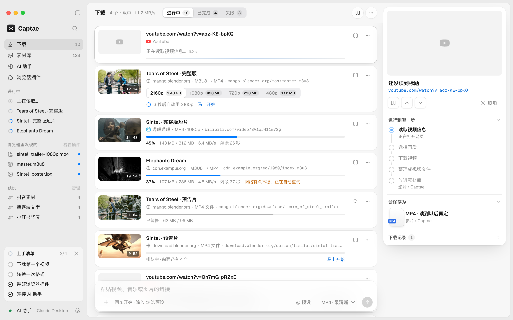
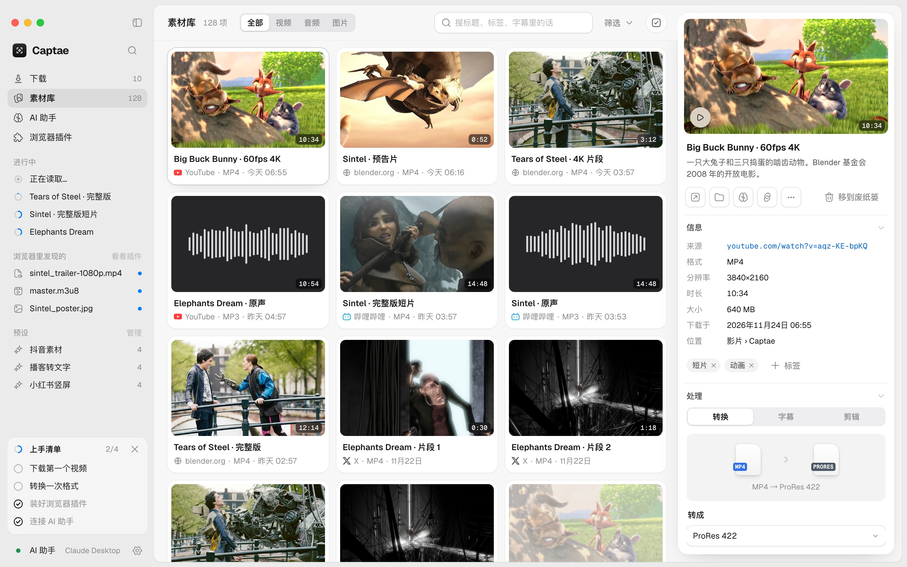
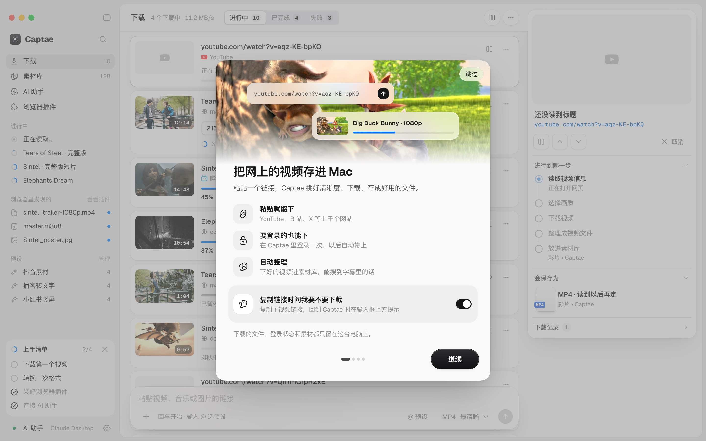
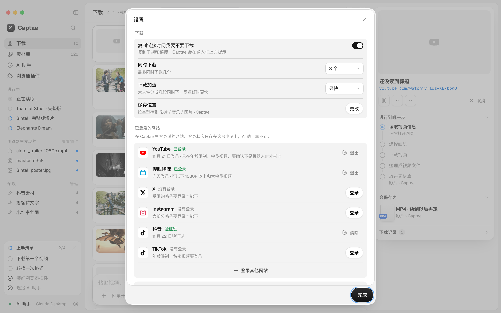
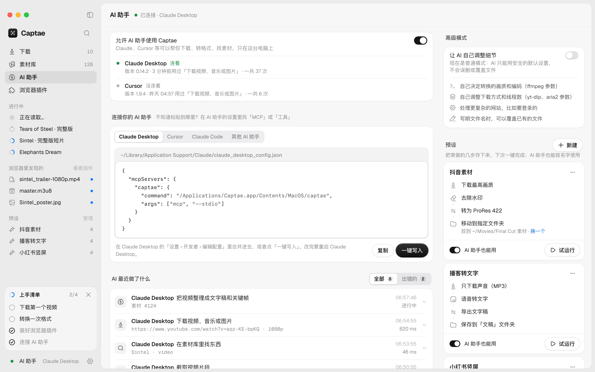

# Captae

[简体中文](README.md) | English

A local media downloader and manager for macOS, Windows and Linux. Paste a link, or click “Download” next to a video in your browser: Captae picks the quality, downloads it, saves it as a file that's easy to use, and adds it to a library you can search by subtitles.
AI assistants such as Claude and Cursor can also have it download, find items and transcribe through MCP. All files, items and sign-ins stay on your own computer. Open source under AGPL-3.0.



## What it does

- **Download**: video and audio from YouTube, Bilibili, X, Douyin / TikTok, Instagram and other sites (web pages go to yt-dlp), M3U8 (HLS) streams and direct media links.
  See how big each quality is before you download; pick what you want from playlists, multi-video posts and Bilibili parts; for a stream that's live, “Record from now”, then “Stop and save” when you have enough.
- **Sites that need sign-in work too**: sign in once in Captae's own sign-in window, or let the browser extension bring along your browser's sign-in (see “Signing in” below).
- **Says why a download failed**: needs sign-in, needs verification, region-locked, blocked by the network, video removed, DRM-protected… Each case has its own explanation and a button for the next step, not a generic “failed”.
- **Library**: downloads are added automatically; search by title, tag and what's said in the subtitles. Convert formats (MP4, WebM, MOV, ProRes, MP3, FLAC…), trim precisely, combine, swap audio tracks, generate and burn in subtitles, Show in Finder.
  You can have your own AI model (DeepSeek, OpenAI, a local Ollama…, with your own key) sort items into categories by content and tag them. Rename or merge the categories as you like, and new downloads are filed automatically. Only titles, descriptions and sources are sent, plus thumbnails when the text says too little.
- **Speech to text**: videos without subtitles are transcribed on your computer into subtitles and a transcript (faster-whisper; audio is never uploaded).
- **Send to AI**: turns a video into a transcript plus key frames on your clipboard. Paste it into an AI chat and the AI can understand the video.
- **Copy a link, then download**: if you copy a video link and open Captae within a minute, it asks on the Downloads page whether to download it (nothing pops up at the moment you copy). You can also paste straight into Captae.
- **Browser extension**: a download button and a quality menu appear next to videos on web pages, with progress in the bottom-right corner. The toolbar panel lists the videos, audio and images you can download from the page, and recent finds also show up in Captae's sidebar.
- **AI assistants**: the MCP server offers tools for downloading, converting, subtitles, trimming, combining, searching and filing the library, presets, Send to AI and more. You can turn it off entirely or allow only some tools, and every call is logged.
- **Languages**: the interface, messages and command line support 简体中文, English, 繁體中文, 日本語, 한국어, Deutsch, Español and Français. It follows your system by default and can be changed in Settings.

| | |
|---|---|
|  |  |
|  |  |

## Recording live streams

- When Captae reads a link that's live right now (radio streams included), it says “This is a live stream in progress”, and recording starts only when you click “Record from now”. While recording, you can click “Stop and save” on the Downloads page, on the extension's card on the web page, or in the extension's toolbar panel;
  what was recorded becomes a playable file in your library. “Cancel recording” deletes what was recorded and asks you to confirm first. If the stream ends on its own, the recording is saved automatically.
- A live link you've recorded doesn't count as “already downloaded”: a live channel's link gives different content each time, so the extension's button, quality menu and toolbar panel never say “Downloaded” for it.
- When an AI assistant asks Captae to record a live stream, it records at most 10 minutes by default (the assistant can ask for a length, up to 180 minutes), then stops and saves automatically. You can also “Stop and save” in Captae any time sooner.
- Command line: `captae download <url> --record-live [--max-minutes N]`. Without `--max-minutes` it keeps recording; press Ctrl-C once to stop and save, and again to quit right away.
  Raw data that hasn't been processed yet is kept: the command line tells you where, and it's deleted automatically after 7 days.
- If Captae quits in the middle of a recording, it processes what was recorded into your library the next time it opens, and tells you once where it is.

## What's supported

- Web videos go through the bundled [yt-dlp](https://github.com/yt-dlp/yt-dlp) (included in the installer and checked for updates every day), which covers over a thousand sites. After a site changes, yt-dlp may not be able to read it for a while;
  Captae then says “The download engine can't read this site right now” and points you to downloading it on the web page with the browser extension (the extension takes the address of the media playing on the page).
- Sites yt-dlp doesn't support, and image posts (RedNote image posts, Douyin photo albums, Flickr…), also go to the extension. WeChat Channels isn't supported yet.
- **No DRM**: for content protected by digital rights management, such as Netflix, Disney+, Spotify, Apple Music and VIP content on video sites, Captae says right away that it can't be downloaded and never tries to get around the protection. When members-only content only gives a preview clip without sign-in, that also counts as failed and isn't added to the library.
- No automatic CAPTCHA solving or filling: when a site asks for verification, Captae opens the page so you can complete it yourself.

**Only download content you have the right to download, and follow the site's terms of service and the laws where you live.** Captae is a tool; how you use it is your responsibility.

## Download

Get the latest version from [Releases](https://github.com/sol1560/Captae/releases/latest): the `.dmg` for macOS (Apple Silicon), the `-setup.exe` for Windows 10 / 11 (x64), and the `.deb` and `.AppImage` for Linux (x86_64).
The same page lists the SHA256 of each file and has the source archives of the bundled GPL programs (FFmpeg, aria2, yt-dlp).

The interface comes in 8 languages (简体中文, English, 繁體中文, 日本語, 한국어, Deutsch, Español, Français). Everything other than Simplified Chinese was translated by AI and hasn't been reviewed by native speakers yet.
If something reads awkwardly, Issues and PRs are welcome (how to write translations: `docs/I18N.md`, in Chinese).

## Install (macOS, Apple Silicon)

1. Open `Captae_<version>_aarch64.dmg` and drag Captae into Applications.
2. The app is signed with an Apple Developer ID certificate and notarized by Apple. The first time you open it, macOS asks whether you're sure you want to open an app downloaded from the internet; click “Open”.
   Packages you build from source yourself aren't notarized (see “Development” below), so macOS blocks them the first time: go to System Settings › Privacy & Security and click “Open Anyway” at the bottom.
3. yt-dlp, deno, ffmpeg and aria2, used for downloading, converting and speeding up downloads, are all included. There's nothing else to install.
4. The first time you use speech to text, click “Download” in the Welcome tour or in Settings (this installs about 60 MB of components and a recognition model of about 480 MB into Captae's data folder).
5. Upgrading: just replace Captae in Applications. Your library, tags, settings and unfinished downloads are kept. If you later go back to an older version, the library still works,
   but once you change settings in the older version, the few settings that only exist in the newer one (update the download engine automatically, proxy, also use sign-ins from your browser) go back to their defaults;
   and when the older version's command line or AI assistant downloads something, unfinished downloads may disappear from the list on the Downloads page (the partly downloaded files are still there).

## Install (Windows 10 / 11, x64)

1. Run `Captae_<version>_x64-setup.exe`. It installs for the current user (in `%LOCALAPPDATA%\Captae` by default) and doesn't need administrator rights. If WebView2 isn't on your computer, the installer downloads it automatically.
2. This version of the installer isn't code-signed, so Windows shows “Windows protected your PC”: click “More info”, then “Run anyway”.
3. yt-dlp, deno, ffmpeg and aria2 are all included. Data is stored in `%LOCALAPPDATA%\Captae\data`, and downloads go to Videos › Captae by default.
4. Uninstalling: uninstall Captae in Settings › Apps. Your data (library, settings, sign-ins) is kept by default; check “Delete the application data” to remove it too. Downloaded videos are never deleted.
5. On Windows, “Also use sign-ins from your browser” can only read Firefox: Chrome, Edge and others encrypt sign-in data in a way only they can unlock. For sites that need sign-in, sign in inside Captae or let the browser extension bring your sign-in along.

## Install (Linux, x86_64)

- **deb** (Ubuntu 22.04 or later, Debian 12): `sudo apt install ./Captae_<version>_amd64.deb` (this also installs the GStreamer components needed to play video). The program is in `/usr/lib/Captae/`, and Captae appears in your app menu.
- **AppImage** (other distributions, glibc 2.35 or later): `chmod +x Captae_<version>_amd64.AppImage`, then run it.
- Data is stored in `~/.local/share/captae`, and downloads go to Videos › Captae (your XDG videos folder) by default.
- Reading sign-ins from Chrome-based browsers needs the system keyring (GNOME Keyring / KWallet) to be unlocked. Flatpak and Snap browsers can't be read.

## Install the browser extension

On macOS, 16 browsers are supported: Chrome (including Beta, Dev, Canary and Chrome for Testing), Chromium, Edge (including Beta, Dev and Canary), Brave, Vivaldi, Opera, Opera GX, Arc and Aside.
On Windows: Chrome, Chromium, all Edge channels, Brave, Vivaldi, Opera, Opera GX and Arc. On Linux: Chrome, Chromium, Edge, Brave, Vivaldi and Opera (Flatpak versions need their sandbox loosened once, as the “Browser extension” page explains; the Snap version of Chromium usually can't connect). Firefox and Safari aren't supported.
The extension isn't in the stores yet, so load it in developer mode:

1. Open Captae, go to the “Browser extension” page in the sidebar (or page 2 of the Welcome tour), choose your browser and click “Install”. This opens that browser's extensions page and shows the extension folder in Finder (File Explorer on Windows, your file manager on Linux).
2. Turn on “Developer mode” in the top-right corner of the extensions page.
3. Click “Load unpacked” and choose the extension folder (`Captae.app/Contents/Resources/extension` on macOS, `extension` in the install folder on Windows, `/usr/lib/Captae/extension` on Linux; you can copy the location on the “Browser extension” page).
4. Back in Captae, once you see “Connected”, you're done. Each time Captae starts, it registers the connector the extension needs with the browsers you have installed, so there's nothing to set up by hand.

## Connect an AI assistant

On Captae's “AI assistant” page:

- **Claude Desktop, Cursor**: click “Add automatically”. It first shows you which config file it will change and what it will add, and writes only after you confirm. Restart the AI assistant afterward.
- **Claude Code**: run the line shown on the page in a terminal; it looks like `claude mcp add captae -- /Applications/Captae.app/Contents/MacOS/captae mcp --stdio`.
- **Other AI assistants that support MCP**: the MCP command is `<Captae's location>/Contents/MacOS/captae mcp --stdio` (`captae.exe` in the install folder on Windows, `/usr/lib/Captae/captae` on Linux; stdio transport). If the assistant supports Skills, click “Export Skill file” and put the file in its skills folder (same content as `skills/captae/SKILL.md`).

On that page you can turn off AI access entirely or turn off individual tools. Only with Advanced mode on can the AI pass its own yt-dlp, aria2 and ffmpeg arguments. AI assistants can't see your sign-ins (cookies); when one asks Captae to download, the sites you've signed in to in Captae are used, just as when you download yourself. Everything it does is listed in “Recent calls”.

## Signing in to sites that need it

- **Sign in inside Captae**: when a download says it needs sign-in, click “Sign in to X” to open a separate sign-in window (the page is the site's own sign-in page, and the toolbar above it shows which site you're entering your password on).
  Once you're signed in, the window closes and the waiting download continues. You can also sign in and out in Settings › Signed-in sites. Verification works the same way: complete it in the window, then click “Done”.
- **Bring your browser's sign-in with the extension**: “Use my sign-in for this site” in the extension panel is on by default (remembered per site), so sites you've signed in to in your browser just work when you download with the extension.
- **Read sign-ins from your browser**: “Also use sign-ins from your browser” in Settings is off by default. Turn it on and pasted links also use your browser's sign-ins (reading Chrome brings up a Keychain prompt; reading Safari needs Full Disk Access for Captae).
- YouTube is the exception: by default no sign-in is used, only for age-restricted videos, members-only videos, or when YouTube asks you to confirm you're not a bot (downloading a lot with an account may get the account limited by YouTube). You'll see a note the first time.
- Sign-ins stay on this computer: sign-ins made in Captae are kept in the sign-in window's own storage, written temporarily for the download engine during a download and deleted afterward; sign-ins brought along by the extension are used only for that one download.

## Development

You need Rust and Node; the end-to-end tests also need ffmpeg, aria2c and yt-dlp on your machine (`brew install ffmpeg aria2 yt-dlp`).

```
cd apps/desktop && npm ci                         # UI dependencies (first time only)
cargo test -p captae-core                         # core library unit tests + end-to-end tests
cargo test -p captae-desktop                      # desktop command allowlist, sign-in window rules, routing
cd apps/desktop && npx tsc --noEmit -p .          # UI type check
cd apps/desktop && npm run build:mock             # demo build: open dist-mock/index.html?mock in a browser to see every screen without a backend
cd apps/desktop && npm run build:popup            # build the extension's toolbar panel into extension/popup/
cargo run -p captae-cli -- mcp --stdio            # MCP server
```

Build the development desktop app with a different identifier and run it with a test data folder; otherwise it gets handed off to the Captae you're using and reads and writes your real data:

```
TAURI_CONFIG='{"identifier":"app.captae.dev"}' cargo build -p captae-desktop
CAPTAE_HOME=<test folder> target/debug/captae-desktop
```

When testing on a computer someone else is using, run the test build with its window hidden and quit it normally when you're done (don't `kill -9` it). How to do that, and the debug switches, are in section 11 of `docs/DESIGN.md`.

To load the extension during development: turn on Developer mode at `chrome://extensions` and load `extension/` from the repository.

Packaging:

```
cargo install tauri-cli --version "^2" --locked   # only once
scripts/build-release.sh                          # prepares the bundled programs, builds the dmg and checks it; strips local paths at build time (the app doesn't contain the packager's user name); building the dmg needs Python 3.11 or later
                                                  # signs automatically and submits to Apple for notarization when a Developer ID certificate is in the keychain and notarization credentials are set up (see section 12 of docs/DESIGN.md)
```

More, all in Chinese: handoff notes `HANDOFF.md` (current state, testing status, what's not done yet), design and architecture `docs/DESIGN.md`, UI guidelines `docs/design/README.md`, motion guidelines `docs/MOTION.md`, localization `docs/I18N.md`,
licensing and business model `docs/LICENSING.md`. Instructions for AI assistants are in English: `skills/captae/SKILL.md`.

## Roadmap

The license will loosen step by step as the project grows:

| When | License for Captae's own code |
|---|---|
| Now | AGPL-3.0-or-later |
| 5,000 stars on GitHub | Start moving to MIT, step by step |
| 10,000 stars on GitHub | Start moving to the Unlicense (public domain) |

This is a long-term commitment, and it means rewriting a lot of the foundations: for each part we have to confirm that all of its code can move to the new license, and rewrite whatever can't.
It only covers Captae's own code; the standalone programs bundled in the installer, such as yt-dlp, FFmpeg and aria2, always keep their own licenses. How it works: `docs/LICENSING.md` (in Chinese).
To make the switch possible, you need to agree to the Contributor License Agreement (CLA) before opening a PR; see `CONTRIBUTING.md` (the agreement has an English version).

## License

Captae's own code is licensed under AGPL-3.0-or-later (`LICENSE`); see “Roadmap” above for the plan to switch later. The yt-dlp, FFmpeg and aria2 bundled in the installer are standalone programs that keep their own licenses (including GPL).
Open-source components, fonts and images used in the interface are listed in `THIRD_PARTY_NOTICES.md` and `licenses/`.

## Sponsor

<a href="https://volae.net"></a>

Thanks to **[Volae](https://volae.net)** for sponsoring Captae.

Volae is a customer relationship and growth system for businesses that sell to companies or to individuals. Your customers are scattered across email, chat, social and outreach; Volae merges each person into one record
(where they came from, what they asked, what they bought, grouped by company for B2B) and hands it to an always-on Coworker that runs the missions you set to win and keep customers. Only the calls that need your judgment land in “Waiting for you”.

- **SEO and GEO**: asks ChatGPT, Perplexity, Gemini and other AI engines the questions real buyers ask, to see whether they mention you, what they say about you and whom they cite. When they get something wrong, it drafts the change to your site for your approval, then asks again after it ships to check that the answer changed.
- **Social**: finds discussions about you across 14 platforms, writes replies and rehearses them first, and posts only after you say yes.
- **B2B prospecting**: finds the right companies and local shops, shows you a few sample emails first, then sends first emails and follow-ups in the style you approved.
- **Customers**: answers your inbox, tracks customer health and writes check-in emails. Questions that keep coming up in support become topics for content and outreach.
- **Getting started**: paste your URL. Your Coworker reads your site, asks up to 4 quick questions, shares its take on your product, buyers and competitors, and drafts your first plan. No forms to fill in or accounts to connect first.
- Use it on the web or from your own Claude Code / Codex. Every plan has every feature and differs only in credits; start free with 200 credits when you add a card (adding a card doesn't charge it).

## Friends

- [LINUX DO](https://linux.do): a Chinese-language tech community about development, AI, open-source software and handy tools.
