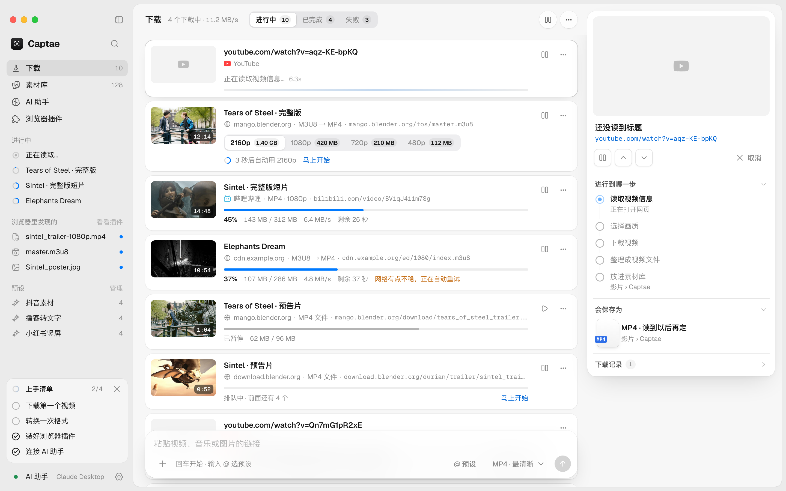

# Captae 界面规范（第二版：轻玻璃）

现在的桌面端界面、插件的网页部件和工具栏面板都照这份做。2026-11-23 定稿，取代第一版设计稿的交接文件（第一版和它的交接文件已删，git 历史里有）。
颜色、圆角、阴影都是 `apps/desktop/src/theme.css` 开头 `:root` 里的变量，改值改那里；动效的规矩和数值另见 `docs/MOTION.md`。

## 1. 规矩

1. **中性近白，不加米黄**。地面和面板是中性的灰白（侧栏 `#ebebeb`、主区 `#f7f7f7`、卡片白）。「温暖」是感觉（友好、柔和），不是颜色。
2. **轻玻璃只给浮在内容上面的东西**：顶栏（列表从它下面滚过）、底部输入框、复制链接的提示、菜单、下拉、右键菜单、小弹层、提示条、多选工具条、插件在网页上的按钮、菜单和进度卡片。
   内容本身（列表、卡片、正文、详情）不透明。
3. **只有一个强调色**：蓝 `#007aff`，只用在进度条、焦点环、选中的单选点、未读圆点、链接。主按钮是近黑胶囊，不是蓝的。
4. **状态色只上在小图标和小字上**：不用彩色大底块，标题旁边不挂状态标签。状态行是浅灰凹面 + 上了色的小图标 + 右边一个下一步按钮。
5. **只用无衬线字**：Geist + 苹方。不用衬线字（用多了就是 AI 生成页面的样子）。
6. **图片用真的**：上手引导和空状态用真实的产品画面或开放电影剧照，不用渐变色块、渐变大头图和装饰图标。
7. **保留原来的 logo**（见第 6 节）。

参考了几款应用的录屏实测（Perplexity Computer Mac 版的版式和质感；ChatGPT、Gemini iOS 版浮在内容上的玻璃控件），数值都量过；和动效课程冲突时以课程为准。

## 2. 颜色

| 变量 | 值 | 用在 |
|---|---|---|
| `--side` | `#ebebeb` | 侧栏（不透明，不做透明窗口） |
| `--main` | `#f7f7f7` | 主区面板（12px 圆角，内嵌在窗口里） |
| `--card` | `#ffffff` | 卡片、浮卡、输入框 |
| `--well` | `#f3f3f3` | 卡片里的凹面（状态行、分段控件的底） |
| `--hover` / `--select` | `rgba(0,0,0,.045)` / `rgba(0,0,0,.065)` | 悬停、选中的底 |
| `--line` / `--line-2` | `rgba(0,0,0,.07)` / `rgba(0,0,0,.12)` | 分隔线、描边 |
| `--ink` | `#171717` | 正文、标题 |
| `--ink-2` | `#525252` | 次要文字 |
| `--ink-3` | `#8b8b8b` | 元信息 |
| `--ink-4` | `#b4b4b4` | 占位、不可用 |
| `--accent` | `#007aff`（文字用 `--accent-ink` `#0066d6`，浅底 `rgba(0,122,255,.1)`） | 唯一的强调色 |
| `--ok` | `#1f8f50` | 成功（小图标） |
| `--warn` | `#c2660a` | 要登录、要验证（小图标） |
| `--err` | `#d6382a` | 失败（小图标） |
| `--scrim` | `rgba(140,140,140,.5)` | 弹窗遮罩：中灰洗白（把 `#f7f7f7` 压到约 `#c1c1c1`），不是压黑 |
| `--glass-dark` | `rgba(26,26,28,.8)` | 深色提示条（白字，内嵌按钮 `rgba(255,255,255,.14)`） |

## 3. 轻玻璃

- 底：`--glass` `rgba(255,255,255,.68)`（主区上用 `--glass-main` `rgba(247,247,247,.74)`，要更实一点用 `--glass-strong` `rgba(255,255,255,.82)`）。
- 背后模糊：`backdrop-filter: blur(24px) saturate(1.8)`（`--glass-blur`）。
- 亮边：内侧 0.5px 白边（`--glass-edge`）。
- 投影：大而淡，`0 0 0 .5px rgba(0,0,0,.08), 0 2px 6px rgba(0,0,0,.04), 0 12px 32px -10px rgba(0,0,0,.16)`（`--glass-shadow`）。
- 系统打开「减少透明度」时，玻璃换成不透明的底色（白 / `#f7f7f7` / `#1c1c1e`）。
- 不给 `backdrop-filter` 做动画（Safari 内核里很快就卡）。macOS 上是 WKWebView，玻璃的样子要在真窗口里看，无界面浏览器的截图不一定画得出模糊。

## 4. 形状和投影

| 什么 | 圆角 |
|---|---|
| 卡片 | 14px（`--r-lg`） |
| 浮卡（右侧详情）、菜单 | 16px（`--r-xl`） |
| 输入框、弹窗 | 20px（`--r-2xl`） |
| 小控件 | 8px、10px（`--r-sm`、`--r-md`） |
| 弹窗和引导里的主要按钮 | 胶囊 |

| 投影 | 值 | 用在 |
|---|---|---|
| `--sh-card` | `0 0 0 .5px rgba(0,0,0,.08), 0 1px 2px rgba(0,0,0,.04)` | 列表里的卡片 |
| `--sh-float` | `0 0 0 .5px rgba(0,0,0,.07), 0 4px 12px -2px rgba(0,0,0,.05), 0 18px 44px -16px rgba(0,0,0,.16)` | 浮卡 |
| `--sh-dialog` | `0 0 0 .5px rgba(0,0,0,.08), 0 24px 70px -16px rgba(0,0,0,.3), 0 8px 20px -8px rgba(0,0,0,.1)` | 弹窗 |

## 5. 字

- 字体：`Geist, "PingFang SC", "Hiragino Sans GB", "Noto Sans SC", system-ui, sans-serif`；等宽 `"Geist Mono"`。Geist 的字体文件随程序和插件一起打包（OFL 1.1）。
- 字号：正文 13.5px；元信息 12–12.5px；页面标题 15px、600；上手引导标题 24px、600。
- 进度、速度、剩余时间、时长这类会变的数字用等宽数字（`font-variant-numeric: tabular-nums`），不做滚动或弹跳。
- 中文名前后不加空格（「登录哔哩哔哩」），英文名加（「登录 YouTube」），统一用 `apps/desktop/src/lib/format.ts` 的 `cjk()`。

## 6. Logo

黑色圆角方块（上 `#2e2e30` 到下 `#0e0e0f` 的竖向渐变，这是 logo 自己的质感，不算「渐变大头图」）里一个白色取景框和中间的圆点，旁边是粗体无衬线字标「Captae」。
应用图标（`apps/desktop/src-tauri/icons/`）、插件图标（`extension/icons/`）、界面里的 logo（`apps/desktop/src/parts/index.tsx` 的 `CaptaeLogo`）是同一个图形。
不要换成线条图标，不要配衬线字。

## 7. 版式

- **窗口骨架**：左边不透明的灰侧栏（logo、搜索、导航「下载 / 素材库 / AI 助手 / 浏览器插件」、进行中、浏览器里发现的（最近 3 条视频和声音，右边「全部 N 个」）、预设、上手清单、AI 助手状态（只写「已连接 / 已连接 N 个 / 未连接 / 已关闭」，不写名字）），
  右边是内嵌的大圆角主区面板。红绿灯和主区顶栏在一条线上。窗口最小 640×560；主区不到 900px 宽时右侧详情改成点开的浮卡，更窄时侧栏变成浮层。
- **下载页**：空的时候居中 logo + 「粘贴链接，开始下载」+ 输入框 + 几个可以直接试的链接（`screenshots/empty.png`）。
  有任务时输入框浮在列表底部（玻璃），列表从它下面滚过；复制了链接的提示贴在输入框上方。顶栏是页面标题 + 进行中 / 已完成 / 失败 + 两个圆形按钮（全部暂停、更多）。
  右侧详情是一张浮卡，分节（进行到哪一步、清晰度、会保存为、下载记录）可以折叠。
- **素材库**：网格卡片（封面、标题、来源、格式、时间），类型分段、搜索、筛选；右边是详情（预览、操作、信息、标签、处理：转换 / 字幕 / 剪辑）（`screenshots/library.jpg`）。
- **设置**：系统设置式的分组，白卡里一行一项（`screenshots/settings.png`）。
- **上手引导**：卡片式弹窗，上半是开放电影剧照 + Captae 真实界面的片段，下半是标题、导语、三条要点和一行操作（`screenshots/onboarding.jpg`）。
- **AI 助手页、浏览器插件页**：同一套顶栏、白卡分组、右列（`screenshots/agent.png`、`screenshots/extension.png`）。
- **登录窗口**：单独的系统窗口，上面一条 Captae 自己的白色工具条（锁 + 网站那块当前的主机名 + 一句话 + 取消 / 完成），中间是网站自己的登录页，底下一行说明。
  工具条不做成玻璃：网站是另一块原生 webview，工具条盖不到网页上。
- **浏览器插件**：网页上的按钮组、清晰度菜单、进度卡片是浅色玻璃（纯 CSS，放在 Shadow DOM 里，不影响网页）；清晰度菜单只列分辨率、格式、大小和「推荐」。
  工具栏面板列出这一页找到的视频、声音和图片，每一条的下载进度、「下载过了」，下面是三个开关（`screenshots/popup.png`）。

## 8. 组件从哪来

- affectUI 免费组件（MIT）：按钮、图标按钮、分段控件、下拉菜单、右键菜单、提示、小弹层、弹窗、开关、选择框、复选框、文本框、转圈、扫光文字等。
  源码原样放在 `apps/desktop/src/components/ui/`（`AFFECTUI-SOURCES.json` 记着来源），只改内容和 props；颜色、曲线通过它的 CSS 变量（`--aui-*`，在 theme.css 里桥接到上面的变量）统一，
  它自带动效和这份规范、`docs/MOTION.md` 不一致的地方在 theme.css 里从外面覆盖。affectUI Pro 等付费库只参考，代码不进仓库。
- Sonner（MIT）：提示条。Hugeicons Free（MIT）：图标。
- 自己写的（`apps/desktop/src/parts/index.tsx` 等）：logo、窗口骨架和侧栏、输入框外壳、进度条、倒计时圆环、步骤时间线、状态互换、引导卡片外壳、插件注入网页的部件。

## 9. 不做

天空或任何彩色背板、渐变大头图中间放一个玻璃方块、米黄底色 + 深青强调色、大标题衬线字、彩色大底块的状态卡、标题旁的状态标签、多个实心主按钮并列、每个标题配一个装饰图标、
常驻界面里无限循环的动画、给 `backdrop-filter` 做动画。
